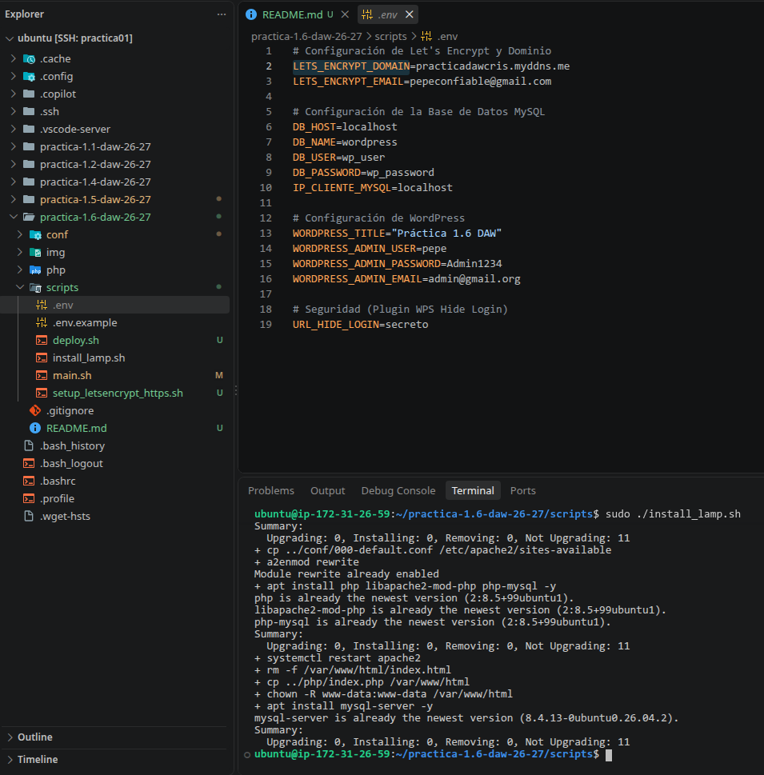
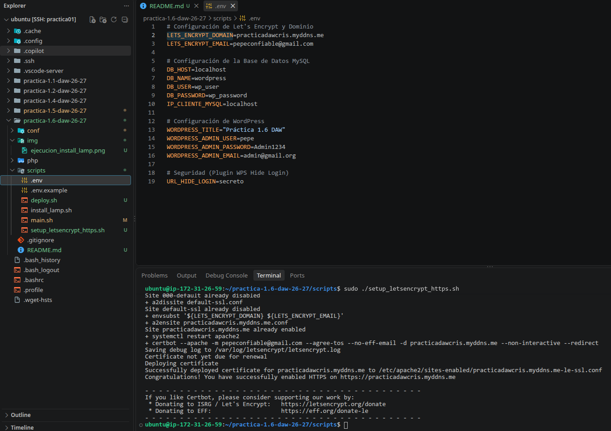
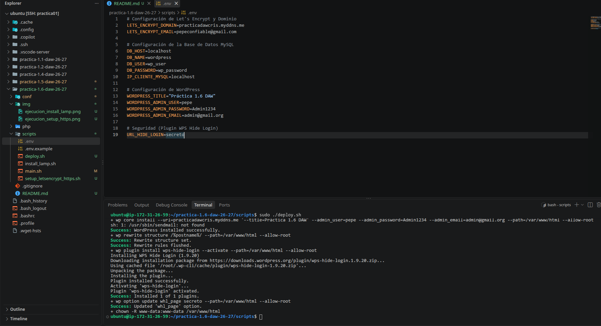
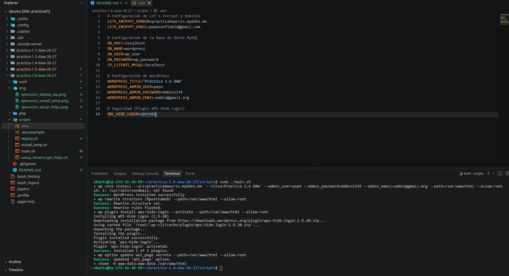
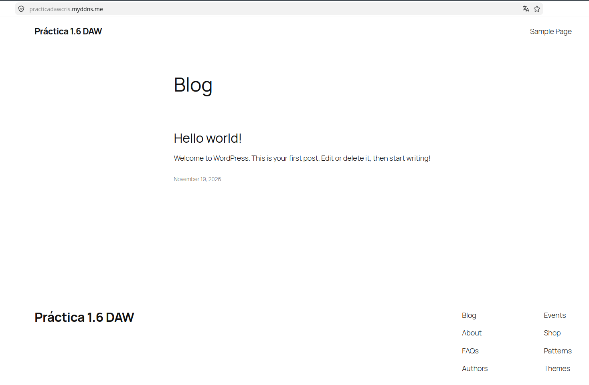
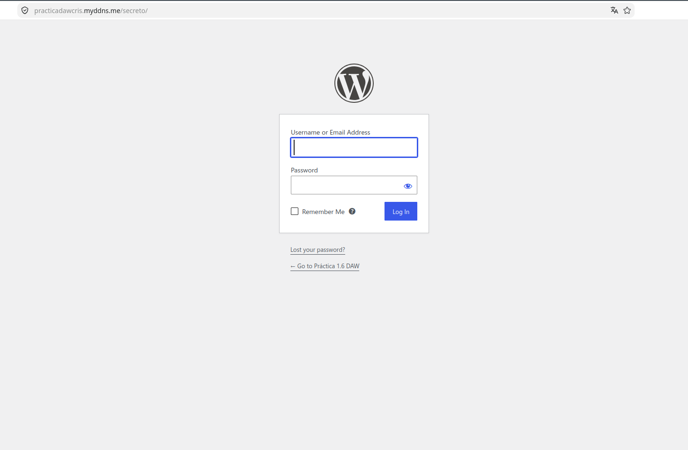

# Práctica 1.6: Despliegue automatizado de LAMP, HTTPS y WordPress en AWS EC2

## 1. Datos de la Infraestructura en AWS

Para la realización de esta práctica se ha empleado la instancia EC2 desplegada en la nube de Amazon Web Services:

- **Nombre de la instancia:** `prueba01`
- **Tipo de instancia:** `t3.medium`
- **Sistema Operativo / AMI:** Ubuntu Server 22.04 LTS / 24.04 LTS
- **Dominio dinámico:** `practicadawcris.myddns.me`
- **Usuario de conexión SSH:** `ubuntu`

## 📁 Estructura del Repositorio

```text
.
├── README.md
├── conf
│   ├── 000-default.conf
│   └── virtualhost.conf.template
├── img
│   ├── ejecucion_install_lamp.png
│   ├── ejecucion_setup_https.png
│   ├── ejecucion_deploy_wp.png
│   ├── ejecucion_main.png
│   ├── wordpress_https_funcionando.png
│   └── wordpress_secreto.png
├── php
│   └── index.php
└── scripts
    ├── .env
    ├── deploy.sh
    ├── install_lamp.sh
    ├── main.sh
    └── setup_letsencrypt_https.sh
```

> **Nota de seguridad:** El archivo `scripts/.env` debe mantenerse excluido en `.gitignore` para evitar exponer contraseñas y datos sensibles en el repositorio público.

---

## 🛠️ Descripción de los Componentes

### 1. Variables de Entorno (`scripts/.env`)
El archivo `.env` centraliza todos los parámetros necesarios para el certificado SSL, la base de datos MySQL, la instalación desatendida de WordPress y el plugin de seguridad:
- **Let's Encrypt:** `LETS_ENCRYPT_DOMAIN` y `LETS_ENCRYPT_EMAIL`.
- **Base de datos MySQL:** `DB_HOST`, `DB_NAME`, `DB_USER`, `DB_PASSWORD` e `IP_CLIENTE_MYSQL`.
- **Instalación de WordPress:** `WORDPRESS_TITLE`, `WORDPRESS_ADMIN_USER`, `WORDPRESS_ADMIN_PASSWORD` y `WORDPRESS_ADMIN_EMAIL`.
- **Seguridad (WPS Hide Login):** `URL_HIDE_LOGIN` para personalizar y ocultar la ruta de acceso al panel de administración.

### 2. Archivos de Configuración (`conf/` y `htaccess/`)
- **`conf/virtualhost.conf.template`**: Plantilla del VirtualHost HTTP (puerto 80) parametrizada con `${LETS_ENCRYPT_DOMAIN}` y `${LETS_ENCRYPT_EMAIL}` para ser procesada mediante `envsubst`.
- **`conf/000-default.conf`**: Configuración base por defecto de Apache con `AllowOverride All` habilitado para permitir reglas de reescritura.
- **`htaccess/.htaccess`**: Reglas de reescritura `mod_rewrite` necesarias para el funcionamiento de los enlaces permanentes (*permalinks*) de WordPress.

### 3. Scripts de Automatización (`scripts/`)
- **`install_lamp.sh`**: Actualiza los repositorios e instala Apache, MySQL Server, PHP y sus extensiones (`libapache2-mod-php`, `php-mysql`) de forma no interactiva, habilitando el módulo `rewrite`.
- **`setup_letsencrypt_https.sh`**: Automatiza la emisión del certificado SSL/TLS con Certbot vía Snap, genera el VirtualHost del dominio con `envsubst`, activa el sitio en Apache y configura la redirección automática de HTTP a HTTPS (`--redirect`).
- **`deploy.sh`**: Realiza la instalación completamente desatendida de WordPress mediante **WP-CLI**:
  1. Descarga e instala `wp-cli.phar` en `/usr/local/bin/wp`.
  2. Limpia `/var/www/html` y descarga el núcleo de WordPress (`wp core download`).
  3. Crea la base de datos y el usuario con sus privilegios en MySQL.
  4. Genera `wp-config.php` (`wp config create`) e instala WordPress sin asistente web (`wp core install`).
  5. Configura la estructura de enlaces permanentes (`/%postname%/`).
  6. Instala y activa el plugin **WPS Hide Login** estableciendo la URL secreta de acceso (`whl_page`).
  7. Asigna la propiedad recursiva de `/var/www/html` al usuario y grupo `www-data`.
- **`main.sh`**: Script orquestador principal que ejecuta de forma secuencial y automática `install_lamp.sh`, `setup_letsencrypt_https.sh` y `deploy.sh`.

---

## 🚀 Guía de Despliegue y Ejecución

### Paso 1: Clonar el repositorio y configurar `.env`
Accede por SSH a la instancia EC2, clona el repositorio y crea el archivo `scripts/.env`:
```bash
git clone https://github.com/LegendAdventure/practica-1.6-daw-26-27.git
cd practica-1.6-daw-26-27/scripts
```

Contenido del archivo `scripts/.env`:
```env
# Configuración de Let's Encrypt y Dominio
LETS_ENCRYPT_DOMAIN=practicadawcris.myddns.me
LETS_ENCRYPT_EMAIL=pepeconfiable@gmail.com

# Configuración de la Base de Datos MySQL
DB_HOST=localhost
DB_NAME=wordpress
DB_USER=wp_user
DB_PASSWORD=wp_password
IP_CLIENTE_MYSQL=localhost

# Configuración de WordPress
WORDPRESS_TITLE="Práctica 1.6 DAW"
WORDPRESS_ADMIN_USER=pepe
WORDPRESS_ADMIN_PASSWORD=Admin1234
WORDPRESS_ADMIN_EMAIL=admin@gmail.org

# Seguridad (Plugin WPS Hide Login)
URL_HIDE_LOGIN=secreto
```

### Paso 2: Ejecución individual de los scripts

#### 2.1. Instalación de la pila LAMP (`install_lamp.sh`)
```bash
chmod +x install_lamp.sh
sudo ./install_lamp.sh
```



#### 2.2. Configuración de certificado SSL y HTTPS (`setup_letsencrypt_https.sh`)
```bash
chmod +x setup_letsencrypt_https.sh
sudo ./setup_letsencrypt_https.sh
```



#### 2.3. Despliegue automático de WordPress (`deploy.sh`)
```bash
chmod +x deploy.sh
sudo ./deploy.sh
```



---

### Paso 3: Orquestación completa con `main.sh`
Para automatizar todo el proceso de despliegue desde cero con una única instrucción, ejecutamos el script principal `main.sh`:
```bash
chmod +x main.sh
sudo ./main.sh
```



---

### Paso 4: Comprobaciones finales
Al acceder desde el navegador a `https://practicadawcris.myddns.me/`, comprobamos que:
1. El tráfico HTTP redirige automáticamente a **HTTPS** con certificado válido de Let's Encrypt.
2. **WordPress** carga directamente instalado y configurado sin mostrar el asistente de instalación web.




3. El acceso tradicional `/wp-admin` queda protegido y el inicio de sesión responde en la ruta personalizada `https://practicadawcris.myddns.me/secreto`.



---

## 🖼️ Capturas de Pantalla y Evidencias

El directorio `img/` recopila todas las verificaciones del despliegue:

| Archivo | Descripción |
| :--- | :--- |
| `ejecucion_install_lamp.png` | Instalación y configuración correcta de Apache, MySQL y PHP. |
| `ejecucion_setup_https.png` | Emisión del certificado SSL de Let's Encrypt y redirección HTTPS. |
| `ejecucion_deploy_wp.png` | Instalación desatendida de WordPress y plugins mediante WP-CLI. |
| `ejecucion_main.png` | Ejecución completa y secuencial de todo el despliegue con `main.sh`. |
| `wordpress_https_funcionando.png` | Verificación de WordPress accesible con certificado HTTPS activo. |
| `wordpress_secreto.png` | Página protegida con el acceso a la ventana "secreto" |